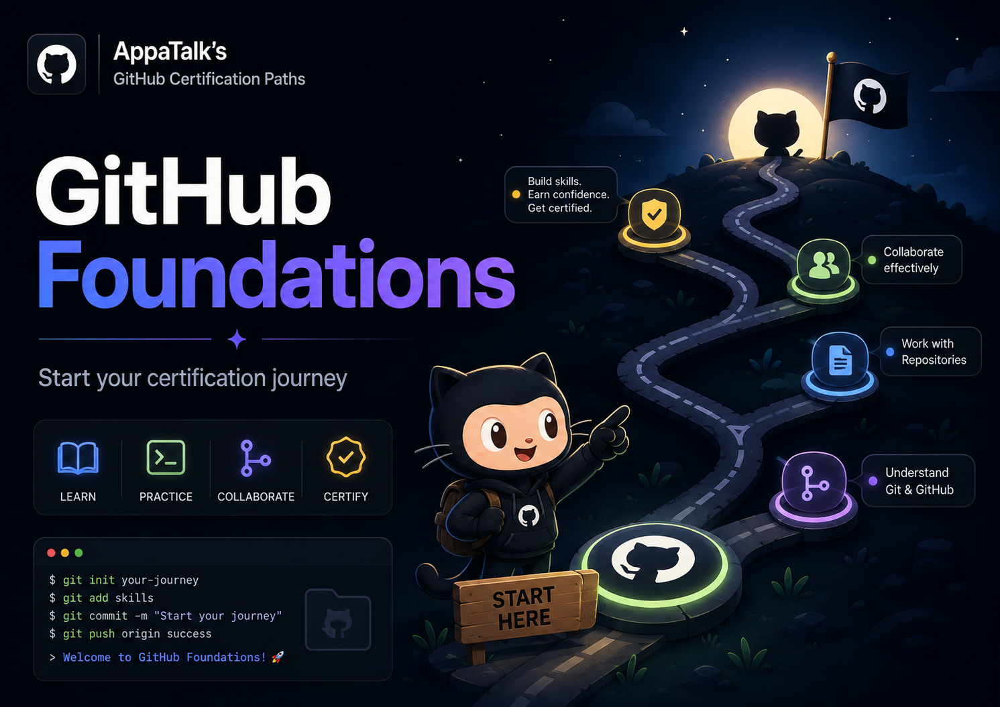
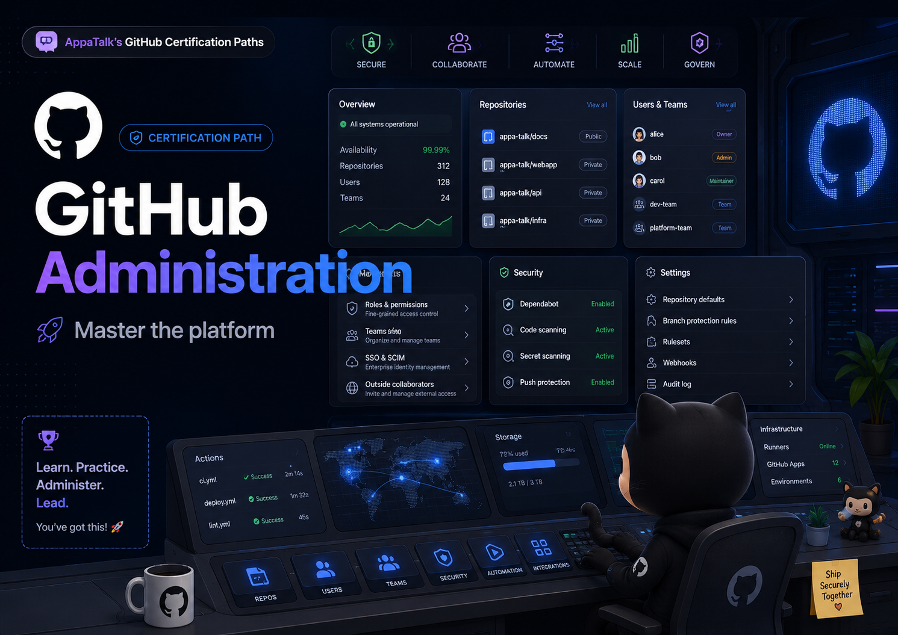
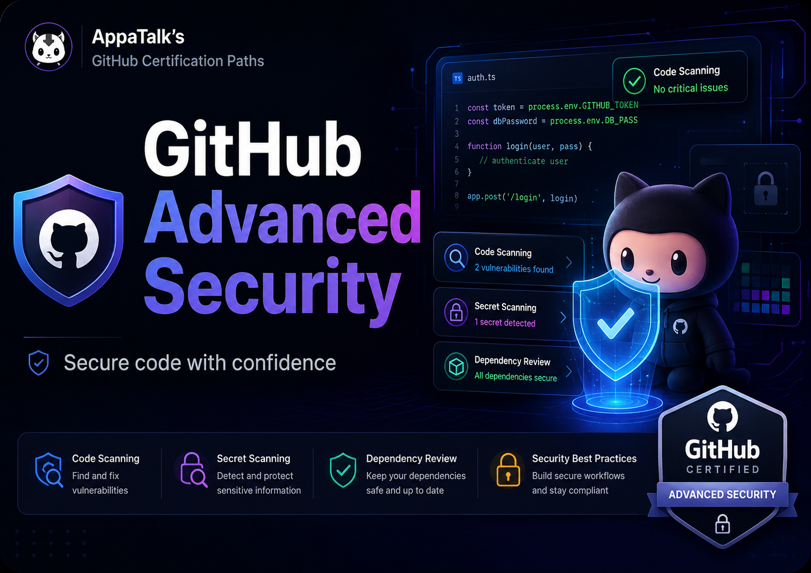
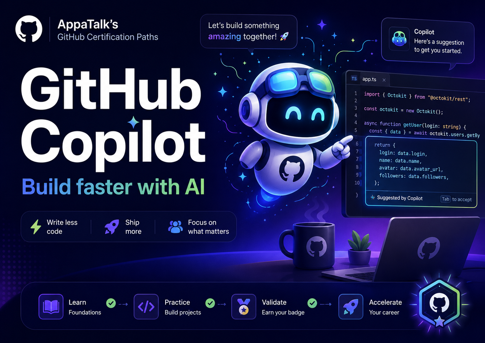
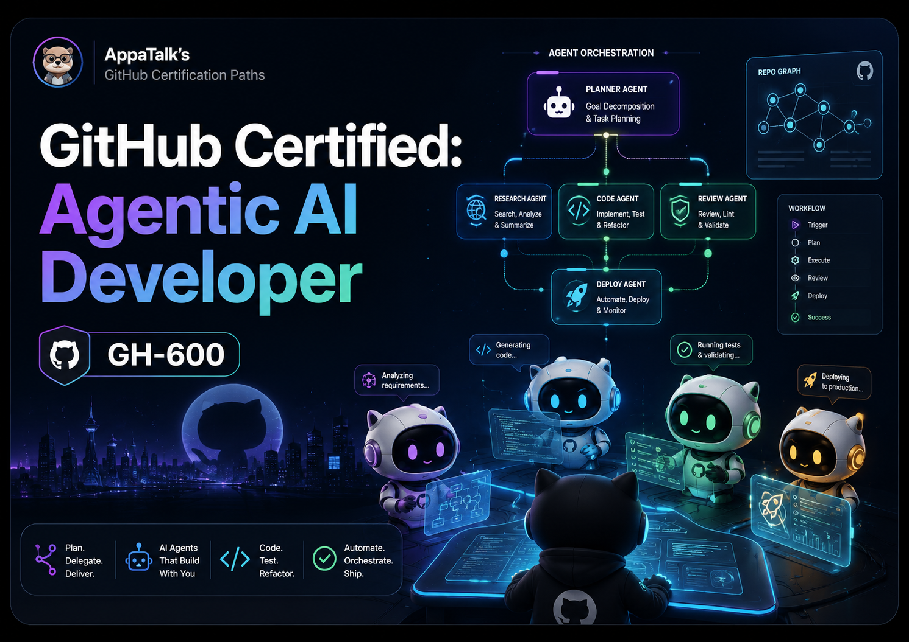

<!-- #  -->

# AppaTalk's GitHub Certification Paths

> [!NOTE]
> A collection of resources designed to help you succeed in your journey to getting certified.

| Foundations | Administration | Actions |
| --- | --- | --- |
|  |  |  |

| Advanced Security | Copilot | Agentic AI Developer | Agentic AI Business Professional |
| --- | --- | --- | --- |
|  |  |  | **GH-700** Enhancing Operational Efficiency with Agentic AI [Study path](Resources/agentic-ai-business-professional/README.md) |

## Agentic AI Business Professional (GH-700)

Start with the [GH-700 study path](Resources/agentic-ai-business-professional/README.md)
for the beta exam **Enhancing Operational Efficiency with Agentic AI**.

## Study Path

1. Review the relevant certification folder in [Resources](Resources/README.md),
    starting with the official references.
2. Use [GitHub's certification preparation resources](https://resources.github.com/learn/certifications/)
    to confirm current exam information.
3. Register through [GitHub Certifications Exam Registration](https://examregistration.github.com/).
4. Record the result and verification link in [Milestones](Milestones/README.md).

## Completed Milestones

| # | Certification | Status | Study guide | Verification |
| --- | --- | --- | --- | --- |
| 1 | GitHub Foundations | PASS | [Guide](Resources/foundations/README.md) | [Credly](https://www.credly.com/badges/e384c423-f21b-43fb-bbfc-4963f9a210d7/public_url) |
| 2 | GitHub Administration | PASS | [Guide](Resources/administration/README.md) | [Credly](https://www.credly.com/badges/96464ff1-71bc-4f83-870e-b3875f532c00/public_url) |
| 3 | GitHub Actions | PASS | [Guide](Resources/actions/README.md) | [Credly](https://www.credly.com/badges/e3e1fba6-bfa5-466e-88a8-08ddcdbc55ae/public_url) |
| 4 | GitHub Advanced Security | PASS | [Guide](Resources/advanced-security/README.md) | [Credly](https://www.credly.com/badges/2502911d-a59d-40a7-8596-d716ccb21739/public_url) |
| 5 | GitHub Copilot | PASS | [Guide](Resources/copilot/README.md) | [Credly](https://www.credly.com/badges/a5b23fd7-a958-45be-b4d5-b0400fa0705d/public_url) |
| 6 | GitHub Certified: Agentic AI Developer (GH-600) | PASS | [Guide](Resources/agentic-ai-developer/README.md) | [Microsoft Learn](https://learn.microsoft.com/en-us/users/stevenbennett-0782/credentials/8133bb3ed12cbea) |

## License

This project is licensed under the [MIT License](LICENSE).

> This is an independently maintained educational project. It is not sponsored
> by, affiliated with, or endorsed by GitHub.
