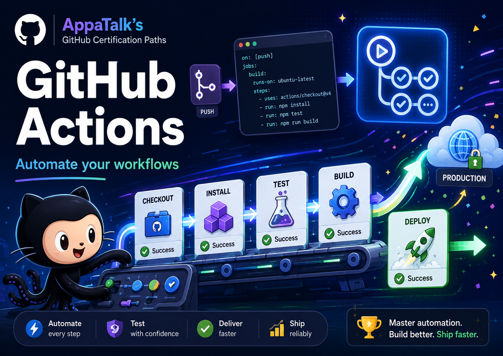

# GitHub Actions (GH-200)

<p align="center"></p>

GH-200 rewards people who can design, operate, secure, and explain automation.
Build a small workflow, deliberately break it, fix it, and then harden it. YAML
syntax matters, but the exam is really testing whether you understand the
system around the YAML.

## Start Here

- [Official certification page](https://learn.microsoft.com/en-us/credentials/certifications/github-actions/): current exam details, policies, and registration.
- [GH-200 study guide](https://aka.ms/GH200-StudyGuide): skills measured and preparation references.
- [GitHub Learn catalog](https://learn.github.com/certification/ACTIONS): official GitHub learning catalog; sign-in may be required.
- [Automate your workflow with GitHub Actions](https://learn.microsoft.com/en-us/training/paths/github-actions/): Microsoft Learn modules for workflows, CI, and GitHub Script.
- [GitHub Actions documentation](https://docs.github.com/en/actions): concepts, how-to guides, reference, and troubleshooting.
- [Official practice assessment](https://learn.microsoft.com/en-us/credentials/certifications/github-actions/): open the practice assessment from the certification page after studying.

## What to Know

The official GH-200 domains are:

1. **Author and manage workflows (20-25%):** events, jobs, steps, actions, expressions, contexts, matrices, artifacts, environments, and reusable workflows.
2. **Consume and troubleshoot workflows (15-20%):** run history, logs, debug logging, reruns, cancellations, permissions, failures, and operational signals.
3. **Author and maintain actions (15-20%):** JavaScript, Docker, and composite actions; metadata; inputs and outputs; versioning; release hygiene; and marketplace sharing.
4. **Manage GitHub Actions for the enterprise (20-25%):** policies, runners, runner groups, secrets, variables, usage, access, and organization or enterprise governance.
5. **Secure and optimize automation (10-15%):** least privilege, safe triggers, secret handling, OIDC, dependency updates, caching, concurrency, and artifact provenance.

Keep the [workflow syntax reference](https://docs.github.com/en/actions/reference/workflows-and-actions/workflow-syntax),
[security reference](https://docs.github.com/en/actions/reference/security/secure-use),
and [runner documentation](https://docs.github.com/en/actions/concepts/runners/github-hosted-runners)
close while practicing.

## Hands-On Missions

### Mission 1: From Push to Green

Complete [Hello GitHub Actions](https://github.com/skills/hello-github-actions),
then add a test workflow. Explain the event, runner, job graph, step execution,
and `GITHUB_TOKEN` permissions.

### Mission 2: Break the Build

Complete [Test with Actions](https://github.com/skills/test-with-actions). Use
logs, the visualization graph, reruns, and debug logging to diagnose a failure.
Write down whether the defect is in the trigger, YAML, runner, dependency,
application, or permission layer.

### Mission 3: Harden the Pipeline

In a disposable GitHub repository, start with this small workflow and make it
safer and more efficient:

```yaml
name: Hardened CI

on:
  push:
  pull_request:
  workflow_dispatch:

permissions:
  contents: read

jobs:
  test:
    runs-on: ubuntu-latest
    steps:
      - uses: actions/checkout@v4
      - run: echo "replace this with the repository test command"
```

Add explicit job permissions, a useful test command, caching where it helps,
concurrency for superseded runs, and an environment for protected deployments.
Then pin third-party actions to reviewed commit SHAs. For the optional cloud
deployment extension, read [OpenID Connect](https://docs.github.com/en/actions/concepts/security/openid-connect)
first and configure a cloud-provider trust relationship, an audience, and the
workflow's `id-token: write` permission. OIDC is provider-specific; do not add a
long-lived cloud credential to the practice repository.

## Quick Self-Check

- What is the difference between an event, a job, a step, and an action?
- When should you use a reusable workflow, composite action, or JavaScript action?
- How do contexts, expressions, variables, and secrets differ?
- Why can `pull_request_target` be risky with untrusted input?
- How do runner choice, caching, concurrency, and artifacts affect cost and speed?

## Keep Current

Actions syntax, runner images, limits, and security guidance change. Verify the
current domains, duration, languages, and practice assessment on the [official
GH-200 page](https://learn.microsoft.com/en-us/credentials/certifications/github-actions/)
before exam day.
